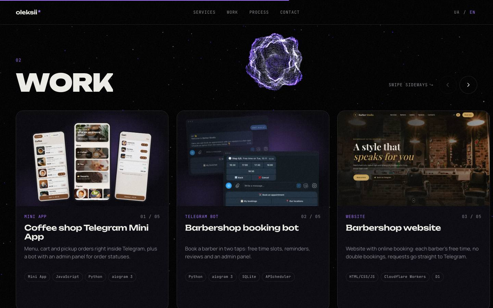
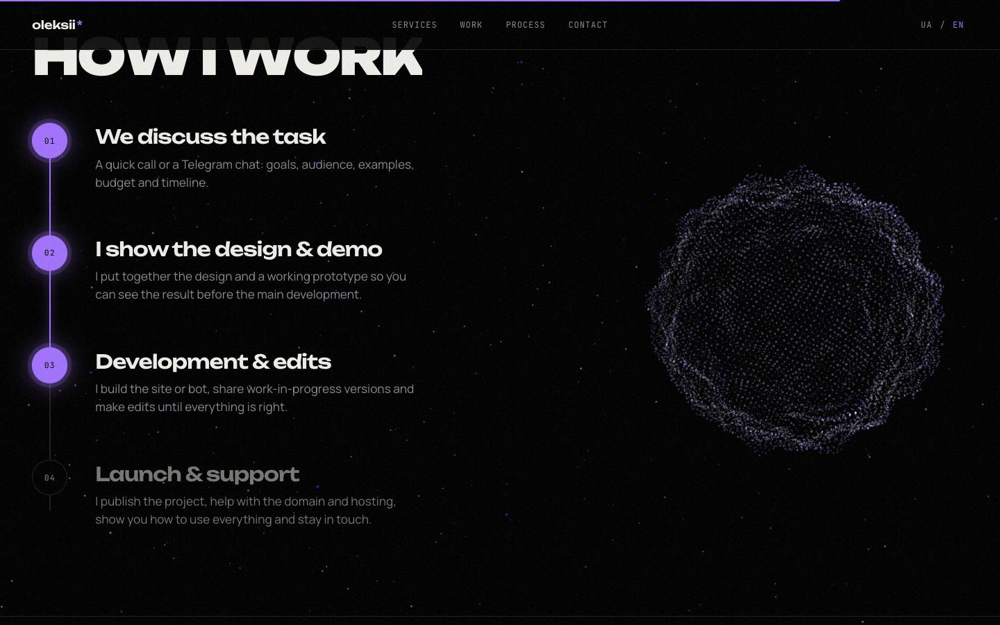
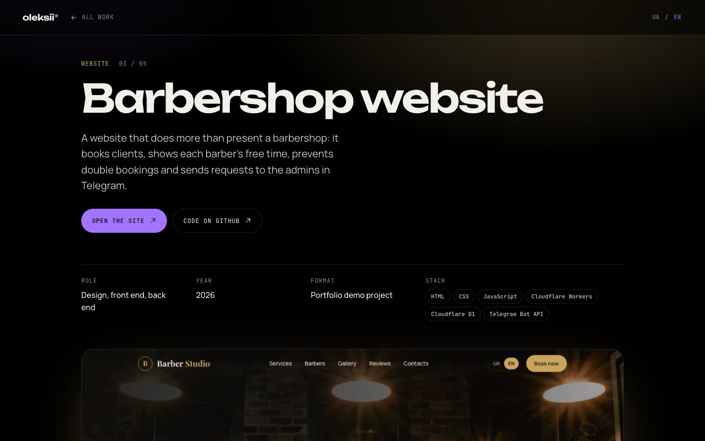

# Oleksii — Web Developer Portfolio

Personal portfolio of Oleksii, a web developer building websites, landing pages, Telegram bots and Telegram Mini Apps for business.

**Live:** https://blessedrbls.github.io/portfolio/


## Features

- **Sphere guide.** One particle sphere (Three.js + custom GLSL shaders) stays behind the whole page and changes its mood (size, position, motion and glow) smoothly from section to section. It reacts to the cursor and bursts into particles as you leave the hero.
- **Starfield journey.** A WebGL starfield moves with the page, and the stars streak into light trails the faster you scroll, while the sphere lags behind and catches up.
- **Live demos.** Project cards open the real site or Mini App inside a phone or browser frame, so visitors can try it without leaving the page. Esc closes it and focus returns to the card.
- **Reactive work section.** A native swipe/drag carousel (touch, trackpad, mouse drag, arrows, keyboard). Hovering a project tints the sphere with that project's colour.
- **Scroll storytelling.** Pinned hero with a letter-by-letter exit, a statement whose words light up as you scroll, and a process timeline whose line draws itself.
- **Services.** Cards with a 3D tilt and a neon border that follows the cursor.
- **Case studies.** Clicking a project card opens its own page (`work/<project>/`): the task, how it works, what was built, technical highlights, a screenshot gallery with full-screen zoom, and what it gives the business. The same sphere guide and starfield run there in the project's colour, with letter-by-letter titles, a cover that opens up on scroll, self-drawing lines and tilting cards. Pages are static HTML, so search engines index them, and the language choice carries over from the main page.
- **Page transitions.** Moving between the home page and case studies plays a two-layer shutter in the project's colour with its name; the next page opens already covered and reveals itself as the sphere assembles. Pages are prefetched on hover, the browser Back button never gets stuck behind the shutter, and with reduced motion navigation is instant.
- **Easter egg.** Type `hello` (or click the logo five times).
- Preloader, custom cursor, magnetic buttons, smooth scrolling (Lenis), film grain.
- **Two languages.** Ukrainian (default) and English, with a smooth switch.







## Performance and accessibility

- **Adaptive quality.** The 3D scene measures frame time and lowers resolution and particle count when needed. Software-rendered GPUs (e.g. Microsoft Basic Render Driver) get a light mode that stops drawing when the page is idle. On normal GPUs the idle scene drops to 30 fps, and it pauses while a demo is open.
- **FPS meter.** Add `?fps` to the URL to see frame rate, quality level and the detected GPU.
- **Lighthouse (desktop):** Accessibility 100, Best Practices 100, SEO 100.
- Respects `prefers-reduced-motion`: everything is visible and readable without animations, and the page still works if the animation libraries fail to load.
- Keyboard-friendly, with a skip link, screen-reader text for animated headings and WCAG-contrast text.
- Responsive images (`srcset`), lazy loading, non-blocking web fonts.
- Open Graph image, favicons and meta tags.

## Tech

Plain static site: `index.html`, `style.css`, `main.js`. No build step.
Libraries are loaded from CDNs with pinned versions: Three.js 0.160.0, GSAP 3.12.5 + ScrollTrigger, Lenis 1.1.13.

## Run locally

Three.js is loaded as an ES module, so open the site through a local server rather than `file://`:

```bash
python3 -m http.server 8000
```

Then open http://localhost:8000.

## Editing projects

Projects are defined in the `PROJECTS` array at the top of `main.js`: title and description in Ukrainian and English, tags, image, tint colour, demo and code links, an optional `preview` (`phone` or `desktop`) for the live demo frame, and a `case` link. Cover images live in `images/` as 1600×1000 `.webp`, with a 1000 px wide `-1000.webp` copy for phones.

## Case study pages

Case texts (both languages) live in `tools/cases-data.mjs`, and screenshots in `images/cases/<project>/`. After editing either, regenerate the pages and `sitemap.xml`:

```bash
node tools/build-cases.mjs
```

The generator reads covers, colours and links from `PROJECTS` in `main.js`, so they stay in one place. Link previews (Open Graph, 1200×630, Ukrainian + English) are rendered from the real 3D scene: start a local server on port 8123 and run `node tools/og-images.mjs` to regenerate `og-image.jpg` and `images/og/*.jpg`. Case pages load the same `main.js` (`<html data-page="case">`) and reuse the 3D scene, cursor and scroll effects; their own styles are in `case.css`. The generated `work/*/index.html` files are committed, so the site still needs no build step to deploy.
