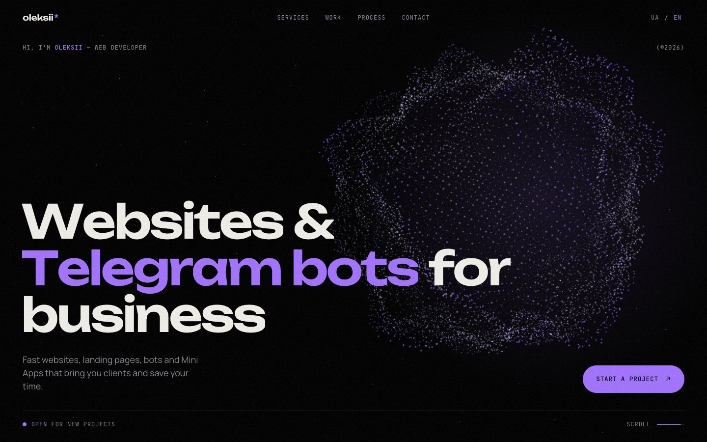

# Oleksii — Web Developer Portfolio

Personal portfolio of Oleksii, a web developer building websites, landing pages, Telegram bots and Telegram Mini Apps for business.

**Live:** https://blessedrbls.github.io/portfolio/



## Features

- **3D hero** — an interactive particle sphere (Three.js + custom GLSL shaders) that reacts to the cursor and explodes into particles as you scroll
- **Scroll storytelling** — pinned hero with a letter-by-letter exit, a statement whose words light up on scroll, a process timeline whose line draws itself (SVG `stroke-dashoffset` + GSAP ScrollTrigger)
- **Services** — cards with a mouse-follow 3D tilt and a cursor-tracking neon border
- **Work** — native swipe/drag carousel (touch, trackpad, mouse drag, arrows, keyboard); project data lives in one `PROJECTS` array in `main.js`
- **Contact** — a big animated call to action and magnetic buttons
- Preloader, custom cursor, smooth scrolling (Lenis), film-grain overlay
- **Two languages** — Ukrainian (default) and English, with a smooth switch
- **Accessible** — respects `prefers-reduced-motion` (everything is visible without animations), keyboard-friendly, skip link
- **Fast on any device** — adaptive 3D quality: phones and software-rendered GPUs get a lighter animated mode
- Open Graph image, favicons and meta tags

## Tech

Plain static site — `index.html`, `style.css`, `main.js`. No build step.
Libraries are loaded from CDNs with pinned versions: Three.js 0.160.0, GSAP 3.12.5 + ScrollTrigger, Lenis 1.1.13.

## Run locally

Three.js is loaded as an ES module, so open the site through a local server rather than `file://`:

```bash
python3 -m http.server 8000
```

Then open http://localhost:8000.

## Editing projects

Projects are defined in the `PROJECTS` array at the top of `main.js` (title and description in Ukrainian and English, tags, image, demo and code links). Cover images live in `images/` (1600×1000 `.webp`).
